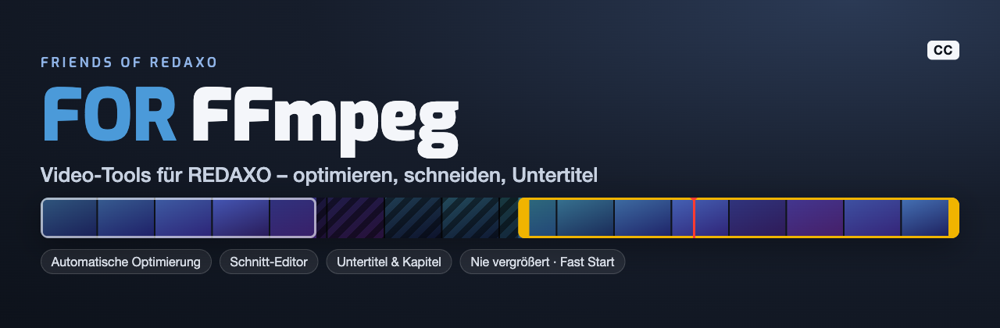
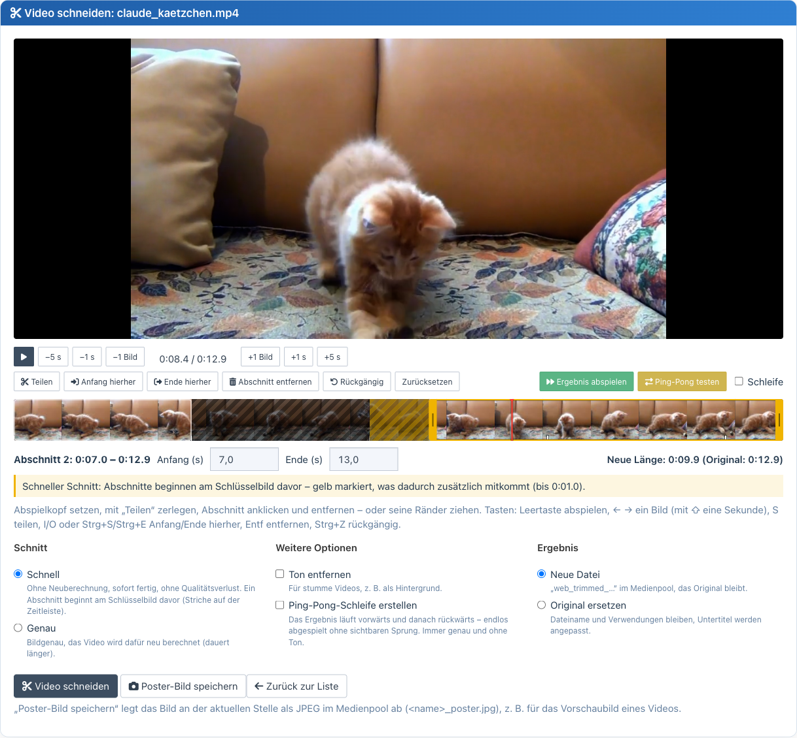
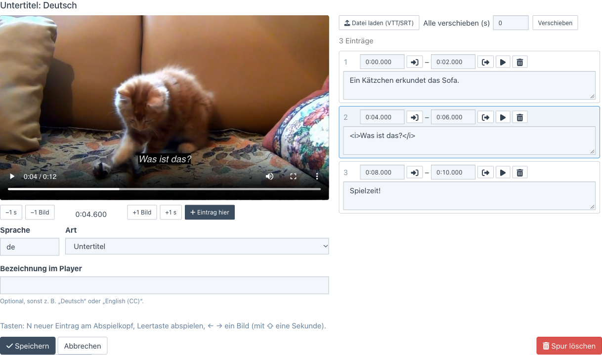

<p align="right">🌎 <a href="https://github.com/FriendsOfREDAXO/ffmpeg/blob/main/README.md">English</a></p>



# REDAXO-AddOn: FFmpeg Video Tools

Vollständige Video-Management-Lösung für REDAXO CMS – automatische Optimierung, Schnitt-Editor, Untertitel und
detaillierte Video-Analyse, alles in einem Addon!

## 🔧 Voraussetzungen

- PHP-Funktion `exec`, `shell_exec` oder `proc_open` aktiviert
- FFmpeg und FFprobe ab Version 4.3 installiert und im PATH verfügbar
- Für die automatische Optimierung empfohlen: das AddOn **Cronjob**
- REDAXO 5.18.1 oder höher
- PHP 8.1 oder höher
- **Wichtig:** Das VideoPreview-Addon muss deinstalliert werden (Funktionalität ist integriert)

## 🚀 Features im Überblick

### Video-Konverter
- **Automatische Optimierung** (neu in 5.0) – neue Videos werden nach dem Hochladen und per Cronjob auf eine Standardgröße heruntergerechnet, siehe unten
- **Hintergrundverarbeitung** – Browser schließen während der Konvertierung möglich; das Ergebnis wird beim nächsten Backend-Aufruf oder Cronjob übernommen
- **Intelligente Medienpool-Integration** mit `web_`-Prefix
- **Metadaten-Erhaltung** (Titel, Beschreibung, Copyright)
- **Kompressionsanzeige** zeigt eingesparten Speicherplatz, getrennt ausgewiesen für Webversion und Optimieren
- **Auto-Cleanup** für Originaldateien nach erfolgreicher Konvertierung (nur Webversion-Modus)
- **Einfache Einstellungen statt FFmpeg-Kommandos**: Größe (Original, Full HD, HD, 480p, 360p), Qualität (hoch, ausgewogen, kleine Datei) und Ton (behalten, Lautstärke angleichen, entfernen) – getrennt für „Optimieren“ (Original ersetzen) und „Webversion erstellen“ (neue Datei)
- **Immer enthalten**: H.264/AAC, browsertaugliches Farbformat (yuv420p), Fast Start (Video startet sofort), nur die erste Bild- und Tonspur. **Videos werden nie vergrößert**, Hochformat bleibt Hochformat (Full HD: höchstens 1920 × 1080 bzw. 1080 × 1920)
- **Mehrere Varianten pro Video**: existiert bereits eine Webversion, bietet ein Dialog neben „Überschreiben“ auch „Zusätzliche Variante anlegen“ mit eigener Größe (`web_<name>_2.mp4`, `_3.mp4`, …)
- **Einstellungs-Hinweis** direkt an den Buttons, z. B. „Full HD · Ausgewogen · mit Ton“

### Video-Trimmer (Schnitt-Editor, neu in 5.0)
- **Zeitleiste mit Vorschaubildern**: teilen, Abschnitte entfernen, Ränder ziehen, rückgängig – auch mehrere Teile herausschneiden
- **Schnell** (ohne Neuberechnung, verlustfrei, ab Schlüsselbild – die Zeitleiste zeigt, was dadurch mitkommt) oder **genau** (bildgenau)
- **Ergebnis abspielen** (Bereichstest) springt über entfernte Teile, **Schleife** und **Ping-Pong testen** für die Vorschau
- **Ton entfernen** und **Ping-Pong-Schleife erstellen** (vorwärts + rückwärts, nahtlos) wie bisher
- Ergebnis als **neue Datei** (`web_trimmed_…`) oder **anstelle des Originals** – Untertitel werden mitgeschnitten
- Läuft als **Hintergrund-Auftrag** mit Fortschritt; Seite darf geschlossen werden
- **Poster-Bild erstellen**: aktuelle Abspielposition als Standbild (JPEG) im Medienpool speichern
- **Tastatur**: Leertaste, ← → (Bild/Sekunde), S teilen, I/O bzw. Strg+S/Strg+E Anfang/Ende, Entf, Strg+Z



### Untertitel und Kapitel (neu in 5.0)
- **Editor mit Live-Vorschau** im Video: Eintrag am Abspielkopf (Taste N), Zeiten per Knopf oder Eingabe (`1:05.250`)
- Je Video beliebig viele Spuren: **Untertitel**, **Untertitel für Gehörlose** und **Kapitel**, je Sprache
- **Import** von WebVTT und SRT (auch UTF-16/Windows-1252), **alle Einträge verschieben**
- Gespeichert als gesäubertes **WebVTT im Medienpool**, mit dem Video verknüpft; beim Schneiden automatisch mitgeschnitten
- Auslieferung für die Website mit dem richtigen Dateityp (`text/vtt`) – siehe `VideoInfo::trackTags()`



### 🆕 Video-Informationen 
- **Detaillierte technische Analyse** aller Video-Parameter
- **Responsive Darstellung** mit Layout-Schutz
- **Optimierungsempfehlungen** für Web-Performance
- **Audio/Video-Stream-Details** komplett verfügbar

### 🆕 Video-Thumbnails (Media Manager)
- **Automatische Thumbnail-Generierung** aus Videos
- **Media Manager Integration** für responsive Bildgrößen
- **Konfigurierbarer Zeitpunkt** für Thumbnail-Extraktion
- **Fallback-Placeholder** bei FFmpeg-Problemen

### 🆕 PHP-API für Entwickler
- **Module-Integration** mit `VideoInfo` Klasse (`FriendsOfRedaxo\FFmpeg\VideoInfo`)
- **Performance-optimierte Methoden** für häufige Abfragen
- **Template-Integration** für Video-Galerien und responsive Player
- **Optimierungs-Checks** für automatische Qualitätsbewertung

## 📋 Workflow

### Video-Konverter
1. **Medienpool → Video-Tools → Video-Konverter** öffnen
2. Gewünschtes Video in der tabellarischen Übersicht finden
3. Direkt am Eintrag auf **"Dieses Video konvertieren"** klicken
4. **Browser schließen möglich** – Konvertierung läuft weiter
5. Fortschritt direkt am Eintrag verfolgen (Donut + optionales Protokoll)
6. Fertig: Das Ergebnis wird übernommen, sobald die Seite wieder geöffnet wird, beim nächsten Backend-Aufruf oder beim nächsten Cronjob

### Automatische Optimierung
1. **Video-Tools → Einstellungen → Automatische Optimierung** einschalten
2. **Standardgröße** wählen: Full HD (empfohlen), HD oder Klein (z. B. für Hintergrundvideos)
3. Festlegen, ob nur neue oder auch alle vorhandenen Videos bearbeitet werden

Danach wird jedes neu hochgeladene Video sofort im Hintergrund geprüft; der Cronjob „FFmpeg: Videos automatisch
optimieren“ (wird beim Einschalten automatisch angelegt, alle 10 Minuten) arbeitet weitere Videos nacheinander ab und
übernimmt fertige Ergebnisse.

Bearbeitet wird nur, was es nötig hat:

| Befund | Was passiert |
| --- | --- |
| größer als die Standardgröße | heruntergerechnet (nie vergrößert) |
| Datenrate zu hoch | neu berechnet – ersetzt nur, wenn die Datei kleiner wird |
| Codec nicht H.264 (z. B. HEVC vom iPhone) oder Farbformat nicht yuv420p | neu berechnet – ersetzt auch, wenn die Datei größer wird, denn sonst spielt das Video in vielen Browsern nicht |
| nur Fast Start fehlt | verlustfrei umsortiert (Sekunden, keine Neuberechnung) |
| alles in Ordnung | bleibt unverändert |

Dateiname, Titel, Kategorie und alle Verwendungen bleiben erhalten. Bearbeitet werden MP4, M4V und MOV (bei anderen
Formaten müsste sich der Dateiname ändern). Jedes Video wird nur einmal geprüft; wird es ersetzt (neuer Upload),
erneut.

Für einen System-Cronjob oder um den Bestand auf einmal abzuarbeiten:

```bash
php redaxo/bin/console ffmpeg:optimize          # ein Durchgang wie der Cronjob
php redaxo/bin/console ffmpeg:optimize --wait   # alle wartenden Videos nacheinander, wartet auf jedes
```

### Video-Trimmer (Schnitt-Editor)
1. **Medienpool → Video-Tools → Video-Trimmer** aufrufen (oder in der Detailansicht eines Videos „Video schneiden“)
2. Video aus der Liste auswählen (alle Typen verfügbar)
3. Abspielkopf setzen (Zeitleiste anklicken, Pfeiltasten, ±1 Bild/Sekunde) und mit **Teilen** zerlegen
4. Abschnitt anklicken und **entfernen** – oder seine Ränder ziehen bzw. Anfang/Ende genau eintippen
5. **Ergebnis abspielen** prüft das Ergebnis, **Schleife** wiederholt es, **Ping-Pong testen** spielt es vor- und rückwärts
6. **Schnell** oder **Genau** wählen, optional **Ton entfernen** / **Ping-Pong-Schleife erstellen**
7. **Neue Datei** (`web_trimmed_*`) oder **Original ersetzen** – „Video schneiden“ startet den Auftrag
8. **Poster-Bild speichern**: Standbild an der aktuellen Stelle als `<name>_poster.jpg` im Medienpool

### Untertitel
1. **Medienpool → Video-Tools → Untertitel** (oder in der Detailansicht eines Videos „Untertitel“)
2. Video wählen → **Untertitel hinzufügen** oder eine vorhandene Spur **bearbeiten**
3. Sprache, Art und optional die Bezeichnung im Player festlegen
4. Einträge schreiben (N = neuer Eintrag am Abspielkopf) oder eine **VTT/SRT-Datei laden**
5. **Speichern** – die Spur liegt als `<video>-<sprache>.vtt` im Medienpool

### Video-Informationen
1. **Medienpool → Video-Tools → Video-Informationen** öffnen
2. Video aus der Liste auswählen
3. **Komplette technische Analyse** ansehen:
   - Auflösung, Bitrate, Codec, Framerate
   - Audio-Details, Seitenverhältnis
   - Optimierungsempfehlungen mit Score
4. **Direkter Zugang** zu Trimmer und Konverter

## 🔌 PHP-API für Module & Templates

### Basis-Verwendung

```php
<?php
use FriendsOfRedaxo\FFmpeg;

// Video-Informationen in Modulen abrufen
$videoFile = 'REX_MEDIA[1]';
$info = VideoInfo::getBasicInfo($videoFile);

if ($info) {
    echo '<div class="video-info">';
    echo '<h3>' . $info['filename'] . '</h3>';
    echo '<p>Dauer: ' . $info['duration_formatted'] . '</p>';
    echo '<p>Auflösung: ' . $info['width'] . ' × ' . $info['height'] . ' px</p>';
    echo '<p>Seitenverhältnis: ' . $info['aspect_ratio'] . '</p>';
    echo '<p>Dateigröße: ' . $info['filesize_formatted'] . '</p>';
    echo '</div>';
}
?>
```

### Schnelle Einzelwerte

```php
<?php
use FriendsOfRedaxo\FFmpeg;

$videoFile = 'REX_MEDIA[1]';

// Nur Dauer ermitteln (performance-optimiert)
$duration = VideoInfo::getDuration($videoFile);
echo 'Dauer: ' . $duration . ' Sekunden';

// Nur Seitenverhältnis
$ratio = VideoInfo::getAspectRatio($videoFile);
echo 'Format: ' . $ratio;
?>
```

### Web-Optimierung prüfen

```php
<?php
use FriendsOfRedaxo\FFmpeg;

$videoFile = 'REX_MEDIA[1]';
$status = VideoInfo::getOptimizationStatus($videoFile);

if ($status['optimized']) {
    echo '<span class="badge badge-success">Web-optimiert</span>';
} else {
    echo '<span class="badge badge-warning">Nicht optimiert</span>';
    foreach ($status['recommendations'] as $rec) {
        echo '<li>' . $rec . '</li>';
    }
}

echo '<p>Score: ' . $status['score'] . '/100</p>';
?>
```

### Responsive Video-Templates

```php
<?php
use FriendsOfRedaxo\FFmpeg;

$videoFile = 'REX_MEDIA[1]';
$info = VideoInfo::getBasicInfo($videoFile);

if ($info) {
    // CSS-Klasse basierend auf Seitenverhältnis
    $aspectClass = match($info['aspect_ratio']) {
        '16:9' => 'video-widescreen',
        '9:16' => 'video-portrait', 
        '1:1' => 'video-square',
        default => 'video-standard'
    };
    
    echo '<div class="video-container ' . $aspectClass . '">';
    echo '<video controls>';
    echo '<source src="' . rex_url::media($videoFile) . '" type="video/mp4">';
    echo '</video>';
    echo '</div>';
}
?>
```

### Video-Thumbnails generieren

```php
<?php
$videoFile = 'REX_MEDIA[1]';

// WebP-Vorschau (animiert) - benötigt Media Manager Typ mit 'rex_effect_video_to_webp'
$webpPreview = rex_media_manager::getUrl('video_webp', $videoFile);
echo '';

// MP4-Vorschau (ohne Ton) - benötigt Media Manager Typ mit 'rex_effect_video_to_preview'
$mp4Preview = rex_media_manager::getUrl('video_preview', $videoFile);
echo '<video autoplay muted loop><source src="' . $mp4Preview . '" type="video/mp4"></video>';

// Kombination: WebP als Fallback für MP4
echo '<video autoplay muted loop poster="' . $webpPreview . '">';
echo '<source src="' . $mp4Preview . '" type="video/mp4">';
echo '';
echo '</video>';
?>
```

### Video-Galerie mit Thumbnails

```php
<?php
use FriendsOfRedaxo\FFmpeg;

// Video-Liste aus dem Medienpool
$sql = rex_sql::factory();
$videos = $sql->getArray('SELECT filename FROM rex_media WHERE filetype LIKE "video/%"');

echo '<div class="video-gallery">';
foreach ($videos as $video) {
    $filename = $video['filename'];
    $info = VideoInfo::getBasicInfo($filename);
    
    // WebP-Thumbnail für bessere Performance
    $thumbnail = rex_media_manager::getUrl('video_webp_thumb', $filename);
    
    if ($info && $thumbnail) {
        echo '<div class="video-item">';
        echo '<a href="' . rex_url::media($filename) . '" data-lightbox="videos">';
        echo '';
        echo '<div class="video-overlay">';
        echo '<span class="play-button">▶</span>';
        echo '<span class="duration">' . $info['duration_formatted'] . '</span>';
        echo '</div>';
        echo '</a>';
        echo '</div>';
    }
}
echo '</div>';
?>
```

### Verfügbare API-Methoden

- `getInfo($filename)` – Vollständige Video-Informationen
- `getBasicInfo($filename)` – Grundlegende Infos für Templates
- `getDuration($filename)` – Nur Video-Dauer (schnell)
- `getAspectRatio($filename)` – Nur Seitenverhältnis
- `getOptimizationStatus($filename)` – Web-Optimierung mit Score
- `isMobileOptimized($filename)` – Mobile-Kompatibilität prüfen
- `hasFaststart($filename)` – startet das Video sofort (Index am Dateianfang)?
- `tracks($filename)` / `trackTags($filename, $defaultLang)` – Untertitel und Kapitel für die Website

### Untertitel auf der Website

```php
use FriendsOfRedaxo\FFmpeg\VideoInfo;

echo '<video controls src="' . rex_url::media('film.mp4') . '">'
    . VideoInfo::trackTags('film.mp4', 'de')   // <track>-Elemente, deutsche Untertitel voreingeschaltet
    . '</video>';

foreach (VideoInfo::tracks('film.mp4') as $track) {
    // ['file' => 'film-de.vtt', 'url' => '/index.php?rex-api-call=ffmpeg_track&…', 'lang' => 'de', 'kind' => 'subtitles', 'label' => 'Deutsch']
}
```

Die Adresse liefert die Spur als `text/vtt` aus – viele Webserver kennen die Endung `.vtt` nicht und schicken
`text/plain`, das Browser für `<track>` ablehnen.

## 🧩 Eigene Workflows (Erweiterungspunkte und Warteschlange)

Mit einem kleinen Projekt-AddOn (oder im `boot.php` des Projekt-AddOns) lassen sich eigene Abläufe bauen – etwa
mehrere Fassungen nach jedem Upload. Es läuft immer nur eine Konvertierung gleichzeitig; weitere Aufträge kommen in
die **Warteschlange** und laufen nacheinander (weiter nach jedem fertigen Auftrag, per Cronjob und mit
`php redaxo/bin/console ffmpeg:optimize --wait`).

### Beispiel: drei Fassungen nach jedem Upload

```php
use FriendsOfRedaxo\FFmpeg\Presets;
use FriendsOfRedaxo\FFmpeg\Queue;
use FriendsOfRedaxo\FFmpeg\VideoInfo;

rex_extension::register('MEDIA_ADDED', static function (rex_extension_point $ep): void {
    $file = (string) $ep->getParam('filename');
    if (!VideoInfo::isSupportedVideoFile($file)) {
        return;
    }
    $name = pathinfo($file, PATHINFO_FILENAME);
    foreach (['480p', '720p', '1080p'] as $size) {
        // Presets::build(Größe, Qualität, Ton) – nie vergrößert, H.264/AAC, Fast Start
        Queue::add($file, Presets::build($size, 'balanced', 'keep'), $name . '-' . $size . '.mp4', ['size' => $size]);
    }
});
```

`Queue::add(string $video, string $command, ?string $output = null, array $extra = [])`

| Parameter | Bedeutung |
| --- | --- |
| `$video` | Dateiname im Medienpool |
| `$command` | ffmpeg-Kommando mit den Platzhaltern `INPUT` und `OUTPUT.<endung>` – am einfachsten `Presets::build()` |
| `$output` | Dateiname der neuen Fassung im Medienpool (Titel, Beschreibung und Copyright werden übernommen); `null` ersetzt das Original |
| `$extra` | eigene Daten, kommen im Auftrag und in `FFMPEG_JOB_DONE` wieder an |

Die Quelle wird bei Aufträgen aus der Warteschlange nie gelöscht. Weitere Methoden: `Queue::pending()`,
`Queue::remove($id)`.

`Presets::build($size, $quality, $audio)`: `$size` = `original`, `1080p`, `720p`, `480p`, `360p` · `$quality` =
`high`, `balanced`, `small` · `$audio` = `keep`, `normalize` (−16 LUFS), `remove`. `Presets::FASTSTART_REMUX` sortiert
verlustfrei um.

### Erweiterungspunkte

| Erweiterungspunkt | Wann | Subject / Parameter |
| --- | --- | --- |
| `FFMPEG_JOB_COMMAND` | vor jedem Auftrag (Buttons, Automatik, Schnitt, Warteschlange) | Subject: Kommando (änderbar, Platzhalter bleiben) · `video`, `mode` (`new_file`/`overwrite`), `extra` |
| `FFMPEG_JOB_DONE` | nach jedem Auftrag, fertig oder mit Fehler | `job` (`VideoJob`), `video`, `result` (Dateiname des Ergebnisses), `status` (`done`/`error`), `mode`, `extra` |
| `FFMPEG_AUTO_OPTIMIZE` | bevor die automatische Optimierung ein Video bearbeitet | Subject: `[Grund, nicht webtauglich, nur umsortieren]` oder `null`; `null` zurückgeben = überspringen · `media`, `preset` |

Beispiel: nach jeder neuen Fassung ein Poster anlegen und Videos aus einer Kategorie von der Automatik ausnehmen:

```php
rex_extension::register('FFMPEG_JOB_DONE', static function (rex_extension_point $ep): void {
    if ('done' === $ep->getParam('status') && ($ep->getParam('extra')['size'] ?? '') === '1080p') {
        // z. B. Benachrichtigung, eigene Verknüpfung, weiterer Queue::add() …
    }
});

rex_extension::register('FFMPEG_AUTO_OPTIMIZE', static function (rex_extension_point $ep) {
    return 12 === $ep->getParam('media')->getCategoryId() ? null : $ep->getSubject();
});
```

## 🔒 Sicherheit

- Alle Backend-Schnittstellen (`ffmpeg_convert`, `ffmpeg_editor`, `ffmpeg_stream`) sind **nur im Backend** erreichbar,
  verlangen ein **CSRF-Token** und prüfen das Recht `ffmpeg[]` sowie das **Medienpool-Recht für die Kategorie** des
  Videos. Bis 4.9 war `ffmpeg_convert` auch über das Frontend und ohne Token aufrufbar.
- Öffentlich ist nur `ffmpeg_track`: Es liefert ausschließlich `.vtt`-Dateien, die als Untertitel-Spur verknüpft sind
  (die ohnehin im Medienpool liegen), und beachtet `rex_media::isPermitted()` (z. B. Medienschutz von YCom).
- ffmpeg-Kommandos entstehen nur aus festen Einstellungen bzw. PHP-Code; alle Argumente werden einzeln maskiert. Es gibt
  kein Eingabefeld für Kommandos mehr.

## ✨ Neueste Verbesserungen
- Moderne Vorschau-Modal mit Loop-Option für schnelle Prüfungen
- Trimmer-UI mit direkt eingebetteten Controls, Scrubber und Bereichstest
- Theme-optimierte Darstellung für Light-, Dark- und Auto-Theme
- Zuverlässige Initialisierung im REDAXO-Backend auch nach Navigation ohne kompletten Reload

## ⚙️ Installation & Konfiguration

### FFmpeg Installation

**Ubuntu/Debian:**
```bash
sudo apt update
sudo apt install ffmpeg
```

**CentOS/RHEL:**
```bash
sudo yum install epel-release
sudo yum install ffmpeg
```

**macOS (Homebrew):**
```bash
brew install ffmpeg
```

**Test der Installation:**
```bash
ffmpeg -version
ffprobe -version
```

### REDAXO-Konfiguration

1. **Addon installieren** über den Installer oder manuell
2. **Einstellungen** unter Video-Tools → Einstellungen: Größe, Qualität und Ton für „Optimieren“ und
   „Webversion erstellen“, automatische Optimierung, Auto-Cleanup

Eigene FFmpeg-Kommandos lassen sich seit 5.0 nicht mehr eingeben: sie waren fehleranfällig und für Redakteure
unverständlich. Frühere Einstellungen werden beim Update auf die passenden Optionen übertragen.

## 🎛️ Keyboard-Shortcuts

**Video-Trimmer (Schnitt-Editor)**
- **Leertaste** – abspielen / anhalten
- **← / →** – ein Bild zurück / vor (mit **⇧** eine Sekunde), **Pos1 / Ende** – Anfang / Ende
- **S** – am Abspielkopf teilen
- **I / O** oder **Strg + S / Strg + E** – Anfang / Ende des gewählten Abschnitts hierher
- **Entf** – Abschnitt entfernen, **Strg + Z** – rückgängig

**Untertitel**
- **N** – neuer Eintrag am Abspielkopf, **Leertaste** – abspielen, **← / →** – ein Bild (mit **⇧** eine Sekunde)

## 🔧 Technische Details

### Unterstützte Video-Formate
- MP4, AVI, MOV, WMV, WebM, MKV
- Alle von FFmpeg unterstützten Formate

### Naming-Konventionen
- **Konvertierte Videos:** `web_originalname.mp4`
- **Zusätzliche Varianten:** `web_originalname_2.mp4`, `_3.mp4`, … (nächster freier Name)
- **Getrimmte Videos:** `web_trimmed_originalname.mp4` (Ping-Pong: `…_loop.mp4`)
- **Untertitel:** `originalname-de.vtt`, `originalname-en-cc.vtt`, `originalname-de-chapters.vtt`
- **Poster-Bilder:** `originalname_poster.jpg`
- **Duplikate:** Automatischer Counter-Suffix

### Performance-Optimierungen
- **Stream-Copy** für verlustfreies Trimming
- **Lazy Loading** der Video-Informationen
- **Caching** von FFprobe-Ergebnissen
- **Background Processing** für Konvertierungen

## 🐛 Troubleshooting

### "FFmpeg ist nicht verfügbar"
- FFmpeg Installation prüfen: `which ffmpeg`
- PATH-Variable korrekt gesetzt?
- PHP `exec()` Funktion verfügbar?

### "Konflikt mit VideoPreview-Addon"
- Das VideoPreview-Addon muss deinstalliert werden
- Alle Thumbnail-Funktionen sind jetzt im FFmpeg-Addon integriert
- Media Manager Effekt "Video-Vorschau" bleibt unverändert funktional

### Konvertierung startet nicht
- PHP-Zeitlimits erhöhen
- Disk-Space prüfen
- Dateiberechtigungen kontrollieren

### Videos werden nicht angezeigt
- MIME-Types in der Datenbank prüfen
- Browser-Unterstützung für Video-Format

## 📝 Changelog

Alle Änderungen stehen in der [CHANGELOG.md](CHANGELOG.md).

## 📄 Lizenz

Dieses Addon steht unter der MIT-Lizenz. Beiträge sind willkommen!

---

**Entwickelt für REDAXO CMS** – Weil gute Videos eine gute Plattform verdienen! 🎬

## 👥 Credits

- **Lead Development:** Thomas Skerbis ([@skerbis](https://github.com/skerbis))
- **Original Version:** Joachim Dörr ([@joachimdoerr](https://github.com/joachimdoerr))
- **Community:** Friends Of REDAXO
- Schnitt- und Untertitel-Editor nach dem Vorbild des AddOns [video_editor](https://github.com/FriendsOfREDAXO/video_editor) für REDAXO 6
- Beispielvideo in den Screenshots: [Kätzchen](https://pixabay.com/videos/kitten-game-pets-4216/) von Pixabay

**Friends Of REDAXO** - https://github.com/FriendsOfREDAXO
