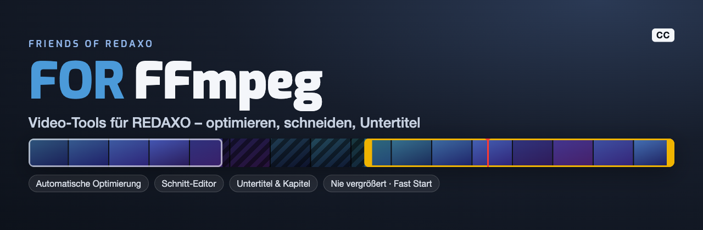
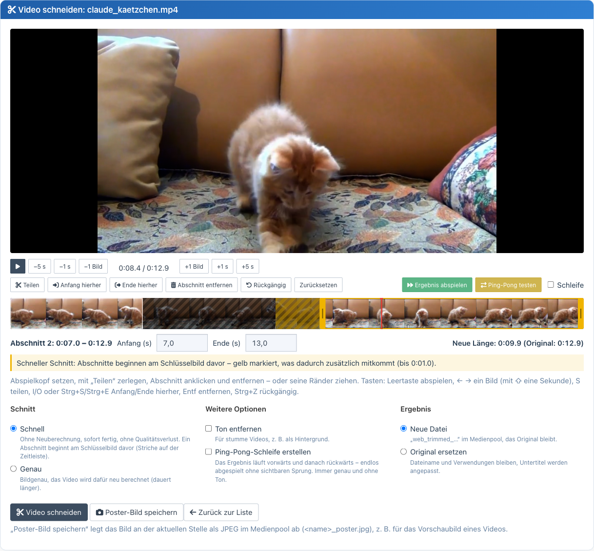
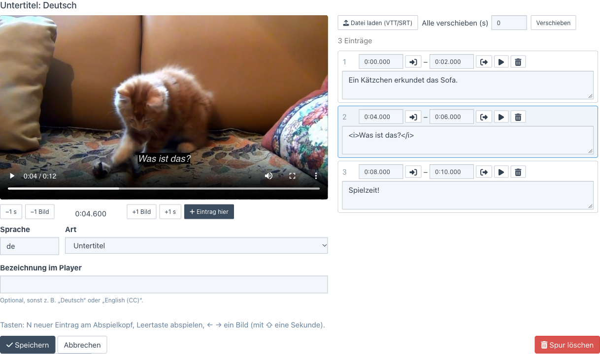

<p align="right">🌎 <a href="https://github.com/FriendsOfREDAXO/ffmpeg/blob/main/README.de.md">Deutsch</a></p>



# REDAXO add-on: FFmpeg Video Tools

Complete video toolkit for REDAXO CMS – automatic optimization, cut editor, subtitles and detailed video analysis,
all in one add-on.

## 🔧 Requirements

- PHP function `exec`, `shell_exec` or `proc_open` enabled
- FFmpeg and FFprobe 4.3 or newer, available in the PATH
- Recommended for automatic optimization: the **Cronjob** add-on
- REDAXO 5.18.1 or newer
- PHP 8.1 or newer
- **Important:** the VideoPreview add-on must be uninstalled (its features are included)

## 🚀 Features

### Video converter
- **Automatic optimization** (new in 5.0) – new videos are scaled down to a standard size after the upload and via cronjob, see below
- **Background processing** – you may close the browser; the result is taken over on the next backend request or cronjob
- **Media pool integration** with `web_` prefix
- **Keeps metadata** (title, description, copyright)
- **Savings display** for web versions and optimized originals
- **Auto cleanup** of originals after a successful conversion (web version mode only)
- **Simple settings instead of FFmpeg commands**: size (original, Full HD, HD, 480p, 360p), quality (high, balanced, small file) and audio (keep, normalize loudness, remove) – separately for "Optimize" (replace original) and "Create web version" (new file)
- **Always included**: H.264/AAC, browser-compatible pixel format (yuv420p), fast start (plays instantly), only the first video and audio stream. **Videos are never scaled up**, portrait stays portrait (Full HD: at most 1920 × 1080 or 1080 × 1920)
- **Several variants per video**: if a web version exists, a dialog offers "Add another variant" with its own size (`web_<name>_2.mp4`, `_3.mp4`, …)
- **Setting hint** right at the buttons, e.g. "Full HD · Balanced · with audio"

### Video trimmer (cut editor, new in 5.0)
- **Timeline with thumbnails**: split, remove segments, drag edges, undo – cut out several parts at once
- **Fast** (no re-encoding, lossless, from the keyframe – the timeline shows what comes along) or **exact** (frame-accurate)
- **Play result** (range test) skips removed parts, **loop** and **test ping-pong** for the preview
- **Remove audio** and **create ping-pong loop** (forwards + backwards, seamless) as before
- Result as a **new file** (`web_trimmed_…`) or **instead of the original** – subtitles are cut along
- Runs as a **background job** with progress; you may leave the page
- **Create poster image**: current position as JPEG still in the media pool
- **Keyboard**: Space, ← → (frame/second), S split, I/O or Ctrl+S/Ctrl+E start/end, Del, Ctrl+Z



### Subtitles and chapters (new in 5.0)
- **Editor with live preview** in the video: new entry at the playhead (key N), times via button or input (`1:05.250`)
- Any number of tracks per video: **subtitles**, **captions** (for the deaf and hard of hearing) and **chapters**, per language
- **Import** WebVTT and SRT (also UTF-16/Windows-1252), **shift all entries**
- Stored as sanitized **WebVTT in the media pool**, linked to the video; cut along automatically
- Delivered to the website with the right content type (`text/vtt`) – see `VideoInfo::trackTags()`



### Video information
- **Detailed technical analysis** of all video parameters
- **Optimization recommendations** for web performance
- **Audio/video stream details**

### Video thumbnails (media manager)
- **Automatic thumbnails** from videos (animated WebP, muted MP4 preview)
- **Configurable position** for the extraction
- **Fallback placeholder** if FFmpeg fails

### PHP API for developers
- `VideoInfo` class (`FriendsOfRedaxo\FFmpeg\VideoInfo`) for modules and templates
- Subtitles for the website, queue and extension points for your own workflows

## 📋 Workflow

### Video converter
1. Open **Media pool → Video tools → Video converter**
2. Find the video in the list
3. Click **"Convert this video"** at the entry
4. **You may close the browser** – the conversion continues
5. Follow the progress at the entry
6. Done: the result is taken over when the page is opened again, on the next backend request or cronjob

### Automatic optimization
1. Enable **Video tools → Settings → Automatic optimization**
2. Choose the **standard size**: Full HD (recommended), HD or Small (e.g. for background videos)
3. Choose whether only new or also all existing videos are processed

Every uploaded video is then checked right away in the background; the cronjob "FFmpeg: Videos automatisch optimieren"
(created automatically when enabled, every 10 minutes) processes further videos one after another and takes over
finished results.

Only what needs it is processed:

| Finding | What happens |
| --- | --- |
| larger than the standard size | scaled down (never up) |
| bitrate too high | re-encoded – replaced only if the file gets smaller |
| codec not H.264 (e.g. HEVC from an iPhone) or pixel format not yuv420p | re-encoded – replaced even if larger, otherwise the video does not play in many browsers |
| only fast start missing | rearranged losslessly (seconds, no re-encoding) |
| all fine | stays unchanged |

File name, title, category and all usages are kept. MP4, M4V and MOV are processed (other formats would need a new file
name). Every video is checked once; again if it is replaced (new upload) or the standard size changes.

For a system cronjob or to process the existing videos at once:

```bash
php redaxo/bin/console ffmpeg:optimize          # one run like the cronjob
php redaxo/bin/console ffmpeg:optimize --wait   # all waiting videos one after another, waits for each
```

### Video trimmer (cut editor)
1. Open **Media pool → Video tools → Video trimmer** (or "Cut video" in the detail view of a video)
2. Choose a video from the list (all types)
3. Set the playhead (click the timeline, arrow keys, ±1 frame/second) and **split**
4. Click a segment and **remove** it – or drag its edges or type exact start/end times
5. **Play result** checks the result, **loop** repeats it, **test ping-pong** plays it forwards and backwards
6. Choose **fast** or **exact**, optionally **remove audio** / **create ping-pong loop**
7. **New file** (`web_trimmed_*`) or **replace original** – "Cut video" starts the job
8. **Save poster image**: still at the current position as `<name>_poster.jpg` in the media pool

### Subtitles
1. **Media pool → Video tools → Subtitles** (or "Subtitles" in the detail view of a video)
2. Choose a video → **add subtitles** or **edit** an existing track
3. Set language, kind and optionally the label in the player
4. Write entries (N = new entry at the playhead) or **load a VTT/SRT file**
5. **Save** – the track is stored as `<video>-<language>.vtt` in the media pool

### Video information
1. Open **Media pool → Video tools → Video information**
2. Choose a video
3. See resolution, bitrate, codec, frame rate, audio details, aspect ratio and recommendations with a score

## 🔌 PHP API for modules & templates

### Basic usage

```php
<?php
use FriendsOfRedaxo\FFmpeg;

// Get video information in modules
$videoFile = 'REX_MEDIA[1]';
$info = VideoInfo::getBasicInfo($videoFile);

if ($info) {
    echo '<div class="video-info">';
    echo '<h3>' . $info['filename'] . '</h3>';
    echo '<p>Duration: ' . $info['duration_formatted'] . '</p>';
    echo '<p>Resolution: ' . $info['width'] . ' × ' . $info['height'] . ' px</p>';
    echo '<p>Aspect ratio: ' . $info['aspect_ratio'] . '</p>';
    echo '<p>File size: ' . $info['filesize_formatted'] . '</p>';
    echo '</div>';
}
?>
```

### Quick single values

```php
<?php
use FriendsOfRedaxo\FFmpeg;

$videoFile = 'REX_MEDIA[1]';

// Duration only (fast)
$duration = VideoInfo::getDuration($videoFile);
echo 'Duration: ' . $duration . ' seconds';

// Aspect ratio only
$ratio = VideoInfo::getAspectRatio($videoFile);
echo 'Format: ' . $ratio;
?>
```

### Check web optimization

```php
<?php
use FriendsOfRedaxo\FFmpeg;

$videoFile = 'REX_MEDIA[1]';
$status = VideoInfo::getOptimizationStatus($videoFile);

if ($status['optimized']) {
    echo '<span class="badge badge-success">Web-optimized</span>';
} else {
    echo '<span class="badge badge-warning">Not optimized</span>';
    foreach ($status['recommendations'] as $rec) {
        echo '<li>' . $rec . '</li>';
    }
}

echo '<p>Score: ' . $status['score'] . '/100</p>';
?>
```

### Responsive video templates

```php
<?php
use FriendsOfRedaxo\FFmpeg;

$videoFile = 'REX_MEDIA[1]';
$info = VideoInfo::getBasicInfo($videoFile);

if ($info) {
    // CSS class based on aspect ratio
    $aspectClass = match($info['aspect_ratio']) {
        '16:9' => 'video-widescreen',
        '9:16' => 'video-portrait', 
        '1:1' => 'video-square',
        default => 'video-standard'
    };
    
    echo '<div class="video-container ' . $aspectClass . '">';
    echo '<video controls>';
    echo '<source src="' . rex_url::media($videoFile) . '" type="video/mp4">';
    echo '</video>';
    echo '</div>';
}
?>
```

### Generate video thumbnails

```php
<?php
$videoFile = 'REX_MEDIA[1]';

// Animated WebP preview – needs a media manager type with 'rex_effect_video_to_webp'
$webpPreview = rex_media_manager::getUrl('video_webp', $videoFile);
echo '';

// MP4 preview (muted) – needs a media manager type with 'rex_effect_video_to_preview'
$mp4Preview = rex_media_manager::getUrl('video_preview', $videoFile);
echo '<video autoplay muted loop><source src="' . $mp4Preview . '" type="video/mp4"></video>';

// Combined: WebP as fallback for MP4
echo '<video autoplay muted loop poster="' . $webpPreview . '">';
echo '<source src="' . $mp4Preview . '" type="video/mp4">';
echo '';
echo '</video>';
?>
```

### Video gallery with thumbnails

```php
<?php
use FriendsOfRedaxo\FFmpeg;

// Video list from the media pool
$sql = rex_sql::factory();
$videos = $sql->getArray('SELECT filename FROM rex_media WHERE filetype LIKE "video/%"');

echo '<div class="video-gallery">';
foreach ($videos as $video) {
    $filename = $video['filename'];
    $info = VideoInfo::getBasicInfo($filename);
    
    // WebP thumbnail for better performance
    $thumbnail = rex_media_manager::getUrl('video_webp_thumb', $filename);
    
    if ($info && $thumbnail) {
        echo '<div class="video-item">';
        echo '<a href="' . rex_url::media($filename) . '" data-lightbox="videos">';
        echo '';
        echo '<div class="video-overlay">';
        echo '<span class="play-button">▶</span>';
        echo '<span class="duration">' . $info['duration_formatted'] . '</span>';
        echo '</div>';
        echo '</a>';
        echo '</div>';
    }
}
echo '</div>';
?>
```

### Available API methods

- `getInfo($filename)` – complete video information
- `getBasicInfo($filename)` – basic information for templates
- `getDuration($filename)` – duration only (fast)
- `getAspectRatio($filename)` – aspect ratio only
- `getOptimizationStatus($filename)` – web optimization with score
- `isMobileOptimized($filename)` – mobile compatibility
- `hasFaststart($filename)` – does the video start instantly (index at the start of the file)?
- `tracks($filename)` / `trackTags($filename, $defaultLang)` – subtitles and chapters for the website

### Subtitles on the website

```php
use FriendsOfRedaxo\FFmpeg\VideoInfo;

echo '<video controls src="' . rex_url::media('film.mp4') . '">'
    . VideoInfo::trackTags('film.mp4', 'en')   // <track> elements, English subtitles on by default
    . '</video>';

foreach (VideoInfo::tracks('film.mp4') as $track) {
    // ['file' => 'film-en.vtt', 'url' => '/index.php?rex-api-call=ffmpeg_track&…', 'lang' => 'en', 'kind' => 'subtitles', 'label' => 'English']
}
```

The URL delivers the track as `text/vtt` – many web servers do not know the `.vtt` extension and send `text/plain`,
which browsers reject for `<track>`.

## 🧩 Your own workflows (extension points and queue)

With a small project add-on (or in the `boot.php` of your project add-on) you can build your own workflows – e.g.
several versions after every upload. Only one conversion runs at a time; further jobs go into the **queue** and run one
after another (continued after every finished job, by the cronjob and with `php redaxo/bin/console ffmpeg:optimize --wait`).

### Example: three versions after every upload

```php
use FriendsOfRedaxo\FFmpeg\Presets;
use FriendsOfRedaxo\FFmpeg\Queue;
use FriendsOfRedaxo\FFmpeg\VideoInfo;

rex_extension::register('MEDIA_ADDED', static function (rex_extension_point $ep): void {
    $file = (string) $ep->getParam('filename');
    if (!VideoInfo::isSupportedVideoFile($file)) {
        return;
    }
    $name = pathinfo($file, PATHINFO_FILENAME);
    foreach (['480p', '720p', '1080p'] as $size) {
        // Presets::build(size, quality, audio) – never scaled up, H.264/AAC, fast start
        Queue::add($file, Presets::build($size, 'balanced', 'keep'), $name . '-' . $size . '.mp4', ['size' => $size]);
    }
});
```

`Queue::add(string $video, string $command, ?string $output = null, array $extra = [])`

| Parameter | Meaning |
| --- | --- |
| `$video` | file name in the media pool |
| `$command` | ffmpeg command with the placeholders `INPUT` and `OUTPUT.<ext>` – easiest with `Presets::build()` |
| `$output` | file name of the new version in the media pool (title, description and copyright are copied); `null` replaces the original |
| `$extra` | your own data, returned with the job and in `FFMPEG_JOB_DONE` |

The source is never deleted for queued jobs. More methods: `Queue::pending()`, `Queue::remove($id)`.

`Presets::build($size, $quality, $audio)`: `$size` = `original`, `1080p`, `720p`, `480p`, `360p` · `$quality` =
`high`, `balanced`, `small` · `$audio` = `keep`, `normalize` (−16 LUFS), `remove`. `Presets::FASTSTART_REMUX`
rearranges losslessly.

### Extension points

| Extension point | When | Subject / parameters |
| --- | --- | --- |
| `FFMPEG_JOB_COMMAND` | before every job (buttons, automatic optimization, cut, queue) | subject: command (changeable, placeholders stay) · `video`, `mode` (`new_file`/`overwrite`), `extra` |
| `FFMPEG_JOB_DONE` | after every job, done or failed | `job` (`VideoJob`), `video`, `result` (file name of the result), `status` (`done`/`error`), `mode`, `extra` |
| `FFMPEG_AUTO_OPTIMIZE` | before the automatic optimization processes a video | subject: `[reason, not web-compatible, rearrange only]` or `null`; return `null` to skip · `media`, `preset` |

Example: react to a finished version and exclude a category from the automatic optimization:

```php
rex_extension::register('FFMPEG_JOB_DONE', static function (rex_extension_point $ep): void {
    if ('done' === $ep->getParam('status') && ($ep->getParam('extra')['size'] ?? '') === '1080p') {
        // e.g. notification, your own link, another Queue::add() …
    }
});

rex_extension::register('FFMPEG_AUTO_OPTIMIZE', static function (rex_extension_point $ep) {
    return 12 === $ep->getParam('media')->getCategoryId() ? null : $ep->getSubject();
});
```

## 🔒 Security

- All backend endpoints (`ffmpeg_convert`, `ffmpeg_editor`, `ffmpeg_stream`) are reachable **in the backend only**,
  require a **CSRF token** and check the permission `ffmpeg[]` plus the **media pool permission for the category** of the
  video. Up to 4.9, `ffmpeg_convert` was callable via the frontend and without a token.
- Only `ffmpeg_track` is public: it delivers nothing but `.vtt` files linked as subtitle tracks (which are in the media
  pool anyway) and respects `rex_media::isPermitted()` (e.g. YCom media protection).
- ffmpeg commands are built only from fixed settings or PHP code; every argument is escaped. There is no input field for
  commands any more.

## ⚙️ Installation & configuration

### Installing FFmpeg

**Ubuntu/Debian:**
```bash
sudo apt update
sudo apt install ffmpeg
```

**CentOS/RHEL:**
```bash
sudo yum install epel-release
sudo yum install ffmpeg
```

**macOS (Homebrew):**
```bash
brew install ffmpeg
```

**Test:**
```bash
ffmpeg -version
ffprobe -version
```

### REDAXO configuration

1. **Install the add-on** via the installer or manually
2. **Settings** under Video tools → Settings: size, quality and audio for "Optimize" and "Create web version",
   automatic optimization, auto cleanup

Since 5.0, custom FFmpeg commands can no longer be entered: they were error-prone and hard to understand for editors.
Previous settings are mapped to the matching options on update.

## 🎛️ Keyboard shortcuts

**Video trimmer (cut editor)**
- **Space** – play / pause
- **← / →** – one frame back / forward (with **⇧** one second), **Home / End** – start / end
- **S** – split at the playhead
- **I / O** or **Ctrl + S / Ctrl + E** – start / end of the selected segment here
- **Del** – remove segment, **Ctrl + Z** – undo

**Subtitles**
- **N** – new entry at the playhead, **Space** – play, **← / →** – one frame (with **⇧** one second)

## 🔧 Technical details

### Supported formats
- MP4, AVI, MOV, WMV, WebM, MKV
- Everything FFmpeg supports

### Naming
- **Converted videos:** `web_originalname.mp4`
- **Additional variants:** `web_originalname_2.mp4`, `_3.mp4`, … (next free name)
- **Trimmed videos:** `web_trimmed_originalname.mp4` (ping-pong: `…_loop.mp4`)
- **Subtitles:** `originalname-en.vtt`, `originalname-en-cc.vtt`, `originalname-en-chapters.vtt`
- **Poster images:** `originalname_poster.jpg`
- **Duplicates:** automatic counter suffix

## 🐛 Troubleshooting

### "FFmpeg is not available"
- Check the installation: `which ffmpeg`
- Is the PATH set correctly?
- Is one of the PHP functions `exec`, `shell_exec` or `proc_open` allowed?

### "Conflict with the VideoPreview add-on"
- Uninstall the VideoPreview add-on – its thumbnail features are part of this add-on

### Conversion does not start
- Check disk space and file permissions
- Is a job still running? Only one job runs at a time; others wait in the queue

### Videos are not shown
- Check the MIME types in the database
- Browser support for the video format

## 📝 Changelog

See [CHANGELOG.md](CHANGELOG.md).

## 📄 License

MIT license. Contributions are welcome!

## 👥 Credits

- **Lead development:** Thomas Skerbis ([@skerbis](https://github.com/skerbis))
- **Original version:** Joachim Dörr ([@joachimdoerr](https://github.com/joachimdoerr))
- **Community:** Friends Of REDAXO
- Cut and subtitle editor modeled on the add-on [video_editor](https://github.com/FriendsOfREDAXO/video_editor) for REDAXO 6
- Sample video in the screenshots: [Kitten](https://pixabay.com/videos/kitten-game-pets-4216/) from Pixabay

**Friends Of REDAXO** - https://github.com/FriendsOfREDAXO
